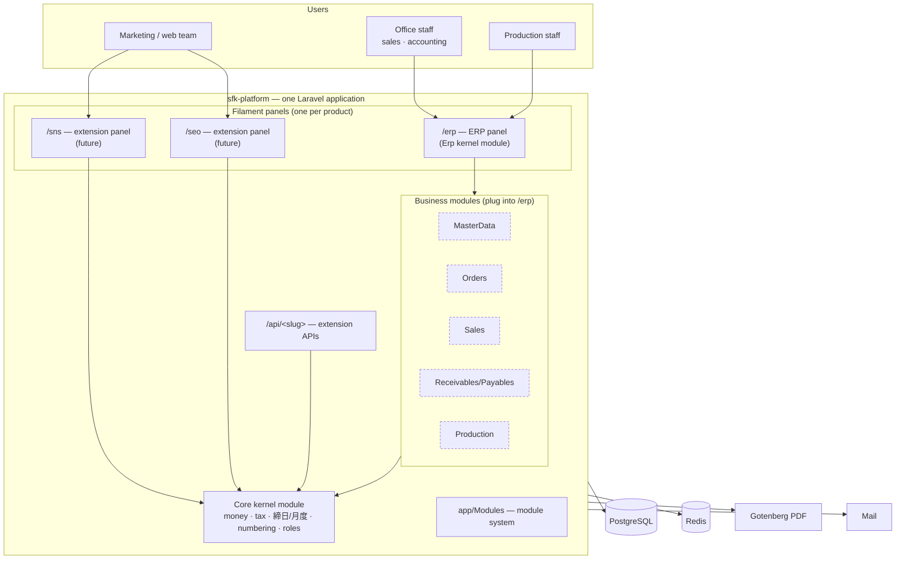
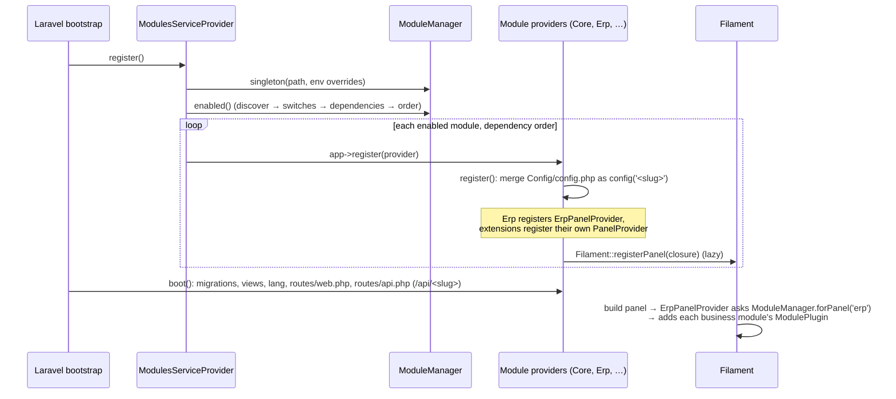
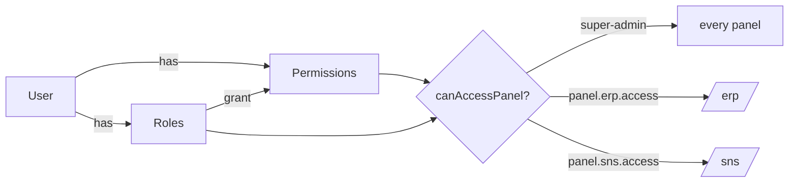

# SFK Platform: Architecture

This document describes the whole project: why it exists, how it is structured, how each part works and the rules for extending it. Code references are relative to `sfk-platform/`.

|                     |                                                                                    |
| ------------------- | ---------------------------------------------------------------------------------- |
| Version             | foundation (Phase 0)                                                               |
| Stack               | PHP 8.4 · Laravel 13 · Filament 5 (Livewire 4) · PostgreSQL 17 · Redis · Gotenberg |
| Style               | Modular monolith                                                                   |
| Requirements source | `SYSTEM_BRAIN/` (local, git-ignored), the reverse-engineered legacy system        |

---

## Contents

1. [Context and goals](#1-context-and-goals)
2. [Technology stack](#2-technology-stack)
3. [System overview](#3-system-overvi
4. [Repository and code layout](#4-repository-and-code-layout)
5. [Module system](#5-module-system)
6. [User interface: panels and plugins](#6-user-interface-panels-and-plugins)
7. [Identity and access control](#7-identity-and-access-control)
8. [Core: the shared business kernel](#8-core-the-shared-business-kernel)
9. [Data architecture](#9-data-architecture)
10. [Layering and dependency rules](#10-layering-and-dependency-rules)
11. [Cross-cutting concerns](#11-cross-cutting-concerns)
12. [Environments and deployment](#12-environments-and-deployment)
13. [Testing and quality](#13-testing-and-quality)
14. [Walkthrough: adding an extension product](#14-walkthrough-adding-an-extension-product)
15. [Security](#15-security)
16. [Roadmap and mapping to the old system](#16-roadmap-and-mapping-to-the-old-system)
17. [Architecture decisions](#17-architecture-decisions)
18. [Known limitations and open items](#18-known-limitations-and-open-items)
19. [Glossary](#19-glossary)

---

## 1. Context and goals

### 1.1 Background

SFK runs its business on a **legacy no-code database system**: 28 apps covering order intake (注番), estimating, production reports, purchasing, sales, delivery notes, invoices, receipts and receivables/payables. Logic is spread across gusuku **Customine** automations (about 1,600 actions), custom **JavaScript**, **PrintCreator** document templates and 31 plugins.

A full reverse-engineering (`SYSTEM_BRAIN/`) documented 75 business rules and found 13 contradictions and 31 defects. Examples: totals stored and updated by scripts drift; purchases saved by users other than one administrator never reach payables; job cost has two conflicting writers; every billing function depends on a single login.

### 1.2 Goals

| Goal                                                                                | How the architecture supports it                                                         |
| ----------------------------------------------------------------------------------- | ---------------------------------------------------------------------------------------- |
| Replace the legacy system with an equivalent but correct system                               | Business rules implemented once, unit-tested, traced to SYSTEM_BRAIN rule ids            |
| Build step by step                                                                  | Independent business modules; each phase can run in parallel with the legacy system                |
| Add secondary products later (SNS handling, SEO analyzer, …) usable outside the ERP | **Extension modules**: own panel (URL/domain), own API, same users, same codebase        |
| Small team, low operating cost                                                      | One deployable app, one database, standard Laravel tooling                               |
| Financial correctness                                                               | Integer yen, exact decimal maths, derived aggregates, locked numbering, real constraints |
| Maintainability                                                                     | Enforced folder conventions (generator), static analysis, tests on SQLite and PostgreSQL |

### 1.3 Non-goals (for now)

- Microservices or separate frontends: not needed at SFK's scale (dozens of users). Module boundaries keep extraction possible later.
- Multi-tenancy: one company. (The シライシ unit seen in the old system can become roles/branches when its requirements are known.)

---

## 2. Technology stack

| Concern             | Technology                 | Version          | Why                                                                                           |
| ------------------- | -------------------------- | ---------------- | --------------------------------------------------------------------------------------------- |
| Language/runtime    | PHP                        | 8.4              | Modern typing, enums, readonly classes                                                        |
| Framework           | Laravel                    | 13.x             | Mature; queues, scheduler, mail, migrations, testing; common among Japanese vendors           |
| Back-office UI      | Filament (on Livewire)     | 5.9 (Livewire 4) | Forms, tables, filters, bulk actions, multi-panel. Closest to how users work today.      |
| Database            | PostgreSQL                 | 17               | Foreign keys, constraints, row locks, views; strong reporting                                 |
| Cache/queue/session | Redis                      | 7                | Background jobs (bulk invoicing, imports), fast sessions                                      |
| Permissions         | spatie/laravel-permission  | 8.3              | Roles and permissions, per-panel access                                                       |
| Audit trail         | spatie/laravel-activitylog | 5.1              | Change history (the legacy system kept history on every record)                                         |
| PDF                 | Gotenberg (HTML → PDF)     | 8                | Japanese-font documents (delivery notes, invoices, work instructions), replacing PrintCreator |
| Mail (dev)          | Mailpit                    | latest           | Captures outgoing mail locally                                                                |
| Tests               | Pest (+ Laravel plugin)    | 4.x              | Readable tests; run per module                                                                |
| Static analysis     | Larastan (PHPStan)         | 3.x, level 6     | Type safety, Laravel-aware rules                                                              |
| Formatting          | Laravel Pint               | 1.x              | Consistent style                                                                              |
| Containers          | Docker Compose             | —                | Reproducible dev environment                                                                  |
| CI                  | GitHub Actions             | —                | Lint, analysis, tests on SQLite + PostgreSQL                                                  |

---

## 3. System overview



Dashed modules are planned (roadmap Phase 1–4).

---

## 4. Repository and code layout

```
sfk-brain/                              repository root
├── README.md · ARCHITECTURE.md
├── .gitignore                          ignores SYSTEM_BRAIN/, the legacy app templates, gusuku/
└── sfk-platform/
    ├── app/
    │   ├── Models/User.php             platform user (FilamentUser + HasRoles)
    │   ├── Providers/AppServiceProvider.php
    │   └── Modules/                    ── module system (framework glue) ──
    │       ├── ModuleType.php          enum kernel | business | extension
    │       ├── Module.php              immutable manifest value object
    │       ├── ModuleManager.php       discovery, switches, dependency resolution, ordering
    │       ├── ModuleServiceProvider.php   base provider: config/migrations/routes/views/lang
    │       ├── ModulesServiceProvider.php  registers enabled module providers
    │       ├── Filament/BasePanelProvider.php  shared panel setup
    │       ├── Filament/ModulePlugin.php       auto-discovering plugin for business modules
    │       └── Console/{ModuleListCommand,MakeModuleCommand}.php
    ├── modules/
    │   ├── Core/                       kernel: shared business kernel (§8)
    │   │   ├── module.json
    │   │   ├── Access/{Roles,PanelPermission}.php
    │   │   ├── Application/Numbering/DocumentNumberGenerator.php
    │   │   ├── Config/config.php       document sequences
    │   │   ├── Database/Migrations/…create_document_sequences_table.php
    │   │   ├── Database/Seeders/CoreDatabaseSeeder.php
    │   │   ├── Domain/Money/{RoundingMode,Yen}.php
    │   │   ├── Domain/Tax/TaxRate.php
    │   │   ├── Domain/Billing/{ClosingDay,BillingCycle}.php
    │   │   ├── Domain/Calendar/YearMonth.php
    │   │   ├── Models/DocumentSequence.php
    │   │   ├── Providers/CoreServiceProvider.php
    │   │   └── Tests/{Unit,Feature}/
    │   └── Erp/                        kernel: ERP panel shell (§6)
    │       ├── module.json
    │       ├── Config/config.php       panel path/domain/brand
    │       ├── Filament/ErpPanelProvider.php
    │       ├── Filament/NavigationGroup.php
    │       ├── Filament/Widgets/ModulesOverviewWidget.php
    │       ├── Resources/views/widgets/modules-overview.blade.php
    │       ├── Providers/ErpServiceProvider.php
    │       └── routes/web.php          "/" → "/erp"
    ├── stubs/module/{business,extension}/   templates for make:module
    ├── config/modules.php              module path, env switches, reserved slugs
    ├── bootstrap/providers.php         AppServiceProvider + ModulesServiceProvider
    ├── database/                       framework migrations (users, cache, jobs, permissions, activity log)
    ├── docker/ · docker-compose.yml    dev environment (§12)
    ├── docs/                           module guide, roadmap, ADRs
    ├── tests/                          platform tests + Pest.php (binds module tests too)
    ├── phpstan.neon · pint.json · phpunit.xml
    ├── .github/workflows/ci.yml
    └── AGENTS.md / CLAUDE.md           coding rules for developers and AI assistants
```

Namespaces: `App\…` → `app/`, `Modules\…` → `modules/` (PSR-4, `composer.json`).

---

## 5. Module system

### 5.1 Concept

A **module** is a folder `modules/<Name>/` containing a `module.json` manifest. Everything a feature needs (rules, models, migrations, screens, routes, tests) lives inside it. The module system (`app/Modules`) is about 650 lines of framework glue (including comments); no third-party module package is used (see ADR 0001).

### 5.2 Module types

| Type        | Purpose                                                           | UI                                                    | May depend on                      | Disable? |
| ----------- | ----------------------------------------------------------------- | ----------------------------------------------------- | ---------------------------------- | -------- |
| `kernel`    | Foundation: **Core** (shared rules) and **Erp** (ERP panel shell) | Erp owns `/erp`                                       | kernel                             | never    |
| `business`  | ERP features                                                      | `ModulePlugin` added to host panel (`"panel": "erp"`) | kernel + declared business modules | yes      |
| `extension` | Separate products used outside the ERP                            | own panel (id = slug) + `/api/<slug>`                 | kernel only                        | yes      |

### 5.3 Manifest (`module.json`)

```json
{
  "name": "Sales", // StudlyCase; folder + namespace Modules\Sales
  "slug": "sales", // kebab-case; config key, URL, permission, env switch
  "type": "business", // kernel | business | extension
  "description": "Sales lines, delivery notes, invoices",
  "version": "0.1.0",
  "provider": "Modules\\Sales\\Providers\\SalesServiceProvider",
  "filament_plugin": "Modules\\Sales\\Filament\\SalesPlugin", // business only
  "panel": "erp", // business only: host panel
  "depends_on": ["core", "erp", "master-data"],
  "enabled": true, // default switch (env overrides)
  "order": 100 // display/boot order (dependencies always first)
}
```

Slugs that collide with framework config keys (`app`, `auth`, `mail`, `queue`, …) are rejected (`config/modules.php` → `reserved_slugs`).

### 5.4 Enable/disable algorithm (`ModuleManager`)

1. **Discover**: read every `modules/*/module.json`; reject duplicate slugs; sort by `order`, then name.
2. **Switches**: kernel modules are always on. Others use `config('modules.enabled.<slug>')`, which `config/modules.php` fills from `MODULE_<SLUG>_ENABLED` (read in config so `config:cache` works). Otherwise the manifest's `enabled` applies.
3. **Dependencies**: a module whose dependency is missing or disabled is disabled too, with a recorded reason. Repeated until stable, so chains propagate. A kernel module with a missing dependency is a fatal error.
4. **Order**: topological sort (dependencies first, stable by manifest order); circular dependencies are a fatal error.

`php artisan module:list` and the dashboard widget show the result, including reasons such as `dependency [master-data] is disabled`.

### 5.5 Boot sequence



### 5.6 Base module provider conventions (`App\Modules\ModuleServiceProvider`)

| Folder/file in module                       | Loaded as                                                          |
| ------------------------------------------- | ------------------------------------------------------------------ |
| `Config/config.php`                         | merged into `config('<slug>.*')`                                   |
| `Database/Migrations/`                      | migrations (run by `php artisan migrate`)                          |
| `Database/Seeders/<Name>DatabaseSeeder.php` | called by the app `DatabaseSeeder` in dependency order             |
| `routes/web.php`                            | `web` middleware group                                             |
| `routes/api.php`                            | `api` middleware, prefix `/api/<slug>`, route names `<slug>.api.*` |
| `Resources/views/`                          | view namespace `<slug>::`                                          |
| `Resources/lang/`                           | translation namespace `<slug>::`                                   |
| `$commands` property                        | Artisan commands (console only)                                    |
| `registerModule()` / `bootModule()`         | hooks for module-specific bindings, observers, policies, schedules |

Routes are skipped when routes are cached (`route:cache` still includes them because caching runs after registration).

### 5.7 Module anatomy (generated by `make:module`)

```
modules/<Name>/
  module.json
  Providers/<Name>ServiceProvider.php
  Config/config.php
  Domain/             pure business rules — value objects, enums, calculators (no framework, no DB)
  Application/        use cases/actions (one class per operation; owns transactions)
  Models/             Eloquent models
  Database/Migrations · Database/Seeders
  Filament/           business: <Name>Plugin.php + Resources/ (Pages/, Widgets/ optional)
                      extension: <Name>PanelProvider.php + Resources/ Pages/ Widgets/
  Http/Controllers/   (extension) API / public endpoints
  routes/web.php · routes/api.php   (extension)
  Tests/Unit · Tests/Feature
  README.md
```

### 5.8 Generator (`php artisan make:module`)

`make:module {name} {--type=business|extension} {--slug=} {--panel=erp} {--description=}`

It validates the name (StudlyCase), slug (kebab-case, not reserved, not existing) and type (kernel modules cannot be generated). It then copies `stubs/module/<type>/`, replacing `{{ name }}`, `{{ slug }}`, `{{ SLUG_ENV }}`, `{{ title }}`, `{{ panel }}`, `{{ description }}` in file names and contents, and prints next steps. Generated modules pass Pint, PHPStan and their own tests out of the box (verified).

---

## 6. User interface: panels and plugins

### 6.1 Panels

A **panel** is a Filament application with its own URL, login page, navigation and access rule.

| Panel id | Owner                 | Path (default)                  | Own domain            | Content                          |
| -------- | --------------------- | ------------------------------- | --------------------- | -------------------------------- |
| `erp`    | Erp kernel module     | `/erp` (`ERP_PANEL_PATH`)       | `ERP_PANEL_DOMAIN`    | dashboard + all business modules |
| `<slug>` | each extension module | `/<slug>` (`<SLUG>_PANEL_PATH`) | `<SLUG>_PANEL_DOMAIN` | the extension's own screens      |

All panels extend `App\Modules\Filament\BasePanelProvider::configureBase()`, which sets id/path/domain, the login page, the shared `web` guard, brand name, colours (primary Blue, gray Slate), collapsible sidebar, the standard middleware stack (cookies, session, CSRF via `PreventRequestForgery`, bindings, Filament events) and `Authenticate` as auth middleware.

The **ERP panel** (`Modules\Erp\Filament\ErpPanelProvider`) is the default panel. It registers the Dashboard with `AccountWidget` and `ModulesOverviewWidget` (super-admins only), the Japanese navigation groups, and one plugin per enabled business module whose manifest has `"panel": "erp"`.

### 6.2 Business modules as plugins

`App\Modules\Filament\ModulePlugin` locates its own folder by reflection and calls `discoverResources/Pages/Widgets` for `Filament/Resources`, `Filament/Pages` and `Filament/Widgets` next to it. A business module therefore only creates resource classes; no panel code changes are needed.

### 6.3 Navigation groups (ERP)

Defined once in `Modules\Erp\Filament\NavigationGroup`, in sidebar order:

| Enum case      | Label      | Old apps     |
| -------------- | ---------- | -------------------- |
| MasterData     | マスタ     | 01, 02, 03, 19       |
| Orders         | 受注・見積 | 04, 09               |
| Production     | 生産       | 08, 12, 13, 14       |
| Purchasing     | 購買・支払 | 05, 07, 15, 20       |
| Sales          | 売上・請求 | 06, 10, 11           |
| Accounting     | 売掛・買掛 | 21, 23, 23-2, 23買掛 |
| Analytics      | 分析       | 22, 25               |
| HumanResources | 人事・安全 | 16, 17, 18           |
| System         | システム   | —                    |

Resources assign themselves with `protected static string|\UnitEnum|null $navigationGroup = NavigationGroup::Sales->value;`.

### 6.4 Routes today

| Route                               | Purpose                                         |
| ----------------------------------- | ----------------------------------------------- |
| `GET /`                             | redirect to `/erp` (Erp module)                 |
| `/erp`, `/erp/login`, `/erp/logout` | ERP panel                                       |
| `GET /up`                           | health check (Laravel)                          |
| `/api/<slug>/status`                | generated for each extension (example endpoint) |

---

## 7. Identity and access control



- **One user table, one guard (`web`)** for all panels. Each panel has its own login page, but credentials are shared.
- `App\Models\User` implements `FilamentUser`. `canAccessPanel($panel)` returns true for role **`super-admin`** (`Modules\Core\Access\Roles::SUPER_ADMIN`), or for permission **`panel.<panel-id>.access`** (`Modules\Core\Access\PanelPermission::for($id)`). An authenticated user without access gets **403**.
- `CoreDatabaseSeeder` (idempotent) creates the `super-admin` role and one access permission for every registered panel. Re-run it after enabling an extension.
- The app `DatabaseSeeder` runs every enabled module's seeder, then creates the initial administrator from `ADMIN_EMAIL` / `ADMIN_PASSWORD` (role `super-admin`) when those are set.
- **Planned business roles** (from `SYSTEM_BRAIN/11_PERMISSIONS`): accounting administrator, sales, production, approver, factory manager, driver/safety manager. They replace the old system's hard-coded single user. Field-level protection of cost data (worker rates, internal cost) will be enforced server-side, not just hidden.

---

## 8. Core: the shared business kernel

Core holds rules used by several business modules, implemented **once**, framework-free where possible, with tests citing SYSTEM_BRAIN rule ids (ADR 0004).

### 8.1 Money: `Modules\Core\Domain\Money`

| Class                 | Responsibility                                                                                                                       | Rules                                                           |
| --------------------- | ------------------------------------------------------------------------------------------------------------------------------------ | --------------------------------------------------------------- |
| `RoundingMode` (enum) | 端数区分: `Truncate` = 切捨, `RoundUp` = 切上, `HalfUp` = 四捨五入. `fromLabel(null/'')` → `Truncate`                                | BR-TX-01/02                                                     |
| `Yen`                 | `round($amount, RoundingMode)` → int; `multiply()`, `divide()` exact decimals via **bcmath** (scale 10); rejects non-decimal strings | matches the legacy ROUNDDOWN/ROUNDUP/ROUND (toward/away from zero) |

```php
Yen::round('1234.5', RoundingMode::Truncate);   // 1234
Yen::round('-1234.7', RoundingMode::HalfUp);    // -1235  (credit notes)
```

### 8.2 Tax: `Modules\Core\Domain\Tax\TaxRate`

Enum with the legacy labels: `Standard` 10%, `Reduced` 8%, `NonTaxable` 非課税, `OutOfScope` 対象外.

- `taxOn($net, $rounding)`: tax-exclusive (外税), e.g. ¥12,345 → ¥1,234 (切捨). BR-TX-04/05.
- `taxIncludedIn($gross, $rounding)`: tax-inclusive (内税), gross − gross ÷ (1 + rate), e.g. ¥10,000 → ¥909. BR-TX-07.
- `fromLabel()` normalises the full-width `８%` found in old data (contradiction C-07).

### 8.3 Billing cycle: `Modules\Core\Domain\Billing`

| Element                                                  | Behaviour                                                                 | Rule     |
| -------------------------------------------------------- | ------------------------------------------------------------------------- | -------- |
| `ClosingDay` (enum)                                      | 5日, 10日, 15日, 20日, 25日, 末日, 随時請求; `dayOfMonth()`; blank → null | —        |
| `BillingCycle::monthFor($date, $closing)`                | 月度: day ≤ D → same month, else next month; 末日/随時/blank → same month | BR-AR-01 |
| `BillingCycle::effectiveClosingDay($partner, $override)` | per-sale override wins                                                    | BR-AR-02 |
| `BillingCycle::defaultInvoiceDate($closing, $today)`     | 5–25 → that day this month; 末日 → last day of previous month; else today | BR-SA-10 |

### 8.4 Calendar: `Modules\Core\Domain\Calendar\YearMonth`

Immutable month value: `of()`, `fromDate()`, `parse('2026年07月' | '2026-07')`, `next()`, `previous()`, `firstDay()`, `lastDay()`, `key()` → `2026-07` (storage), `label()` → `2026年07月` (display / old format).

### 8.5 Document numbering: `Modules\Core\Application\Numbering\DocumentNumberGenerator`

- Table `document_sequences(key unique, prefix, padding, next_value)`, created lazily from `config('core.sequences')`.
- `next($key)` runs in a transaction: `firstOrCreate`, then `SELECT … FOR UPDATE`, take the value, increment, format. This is concurrency-safe (fixes D-GEN-1). Call it **inside** the transaction that saves the document so a rollback also rolls back the number.
- `peek($key)` previews the next number; `ensureNextAtLeast($key, $n)` continues numbering after migrated legacy data (never moves backwards).

| Key             | Format        | Old system                     |
| --------------- | ------------- | ------------------------------ |
| `order`         | `sfk-0000001` | 04 注番 (BR-OR-01)             |
| `purchase`      | `0000001`     | 05 納品(仕入)入力No (BR-PU-01) |
| `delivery_note` | `0000001`     | 10 納品書番号 (BR-SA-14)       |
| `invoice`       | `0000001`     | 11 請求書番号 (BR-SA-14)       |

(売上No and 見積書番号 formats are unknown in the old system and will be added when confirmed.)

### 8.6 Access constants: `Modules\Core\Access`

`Roles::SUPER_ADMIN`, `PanelPermission::for($panelId)` (see §7).

---

## 9. Data architecture

### 9.1 Principles (derived from the legacy-system audit)

| Problem found in the legacy system                                                | Rule here                                                                                                                      |
| ----------------------------------------------------------------------- | ------------------------------------------------------------------------------------------------------------------------------ |
| Totals stored and incremented by scripts drift (job cost, AR/AP, stock) | **Derive** aggregates from source rows (queries/views). Persist only closed-period snapshots, always re-computable.            |
| Text join keys like `得意先ID_2026年06月`, `2026年06月_仕入先ID`        | Real **foreign keys**; composite **unique constraints** such as `(customer_id, period)`                                        |
| `max(number)+1` duplicates                                              | Locked sequences (§8.5)                                                                                                        |
| Floating rounding, per-formula copies of rounding logic                 | **Integer yen** + `Yen` + per-partner `RoundingMode`                                                                           |
| Lookups copy master data and go stale                                   | Reference masters by FK; **snapshot only what a legal document must freeze** (name, address, T-number, rounding at issue time) |
| No guaranteed uniqueness of month records                               | DB unique constraints instead of query-then-insert                                                                             |

### 9.2 Storage

- **PostgreSQL 17** in Docker and production; SQLite (in-memory) for local tests; CI runs tests on both.
- Each module owns its tables via its own `Database/Migrations`. Framework tables (users, sessions/cache/jobs, permissions, activity log) live in `database/migrations`.
- Current tables: `users`, `password_reset_tokens`, `sessions`, `cache`, `cache_locks`, `jobs`, `job_batches`, `failed_jobs`, spatie permission tables (`roles`, `permissions`, `model_has_roles`, `model_has_permissions`, `role_has_permissions`), `activity_log`, `document_sequences`.
- Time zone `Asia/Tokyo`; encoding UTF-8.

### 9.3 Target domain model (Phase 1–3, from `SYSTEM_BRAIN/04_DATABASE`)

Partners (customers/suppliers with terms) → Jobs (注番, estimate sections as child tables) → Sales lines → Delivery notes (+ lines) → Invoices (+ lines) → Receipts (+ lines) → AR ledger (calendar month and billing cycle); Purchases → AP ledger ← Payments (+ lines); Daily reports (+ task lines) → job actuals, stock movements; masters for employees, machines, consumables. The full ER diagram, 1,199-field data dictionary and relationships are in SYSTEM_BRAIN.

---

## 10. Layering and dependency rules

### 10.1 Inside a module

```
Filament (Resources/Pages/Widgets) ─┐
Http (Controllers)  ─────────────────┼──▶ Application (actions/use cases) ──▶ Domain (rules)
Console / Jobs / Listeners ──────────┘                │
                                                       └──▶ Models (Eloquent) ──▶ DB
```

- **Domain**: no framework, no database, no UI. Pure, unit-tested.
- **Application**: orchestrates Domain + Models, owns transactions, raises events.
- **UI/Http** never contains business logic; it calls Application actions.

### 10.2 Between modules

1. Everything may use **Core**.
2. Business → business only when declared in `depends_on`, and only via the other module's `Application` services or public models. Never its Filament/Http layer.
3. Extensions depend on kernel only. If an extension needs ERP data, it uses an Application service (or internal API) published by the ERP module, so ERP changes don't break it.
4. No cycles (the manager refuses to boot).

---

## 11. Cross-cutting concerns

| Concern         | Current implementation                                                                   | Plan                                                                |
| --------------- | ---------------------------------------------------------------------------------------- | ------------------------------------------------------------------- |
| Locale / time   | `ja`, `ja_JP` faker, `Asia/Tokyo` defaults (`config/app.php`, `.env`)                    | —                                                                   |
| Audit trail     | activity log tables installed                                                            | add `LogsActivity` to business models                               |
| Background work | queues (Redis in Docker; `database` locally), `queue` and `scheduler` services in Docker | bulk invoicing, month opening, CSV imports as queued jobs           |
| Mail            | SMTP → Mailpit in dev                                                                    | document e-mailing (invoices/delivery notes)                        |
| PDF             | Gotenberg service + `GOTENBERG_URL`                                                      | Core/Documents service: Blade templates → PDF, stored on the record |
| Configuration   | `.env` → `config/*.php` + module `Config/config.php`; cache-safe                         | —                                                                   |
| Logging         | Laravel stack/single                                                                     | central log shipping in production (TBD)                            |
| Assets          | Filament assets published to `public/` (`filament:upgrade` runs on composer dump)        | custom Vite theme if branding requires                              |

---

## 12. Environments and deployment

### 12.1 Docker services (`docker-compose.yml`)

| Service     | Image                                                                                                 | Port | Role                                             |
| ----------- | ----------------------------------------------------------------------------------------------------- | ---- | ------------------------------------------------ |
| `app`       | `docker/php/Dockerfile` (php:8.4-fpm + pdo_pgsql, intl, bcmath, zip, gd, opcache, pcntl, exif, redis) | —    | PHP-FPM                                          |
| `web`       | nginx:1.27-alpine                                                                                     | 8080 | HTTP → app:9000                                  |
| `queue`     | same as app                                                                                           | —    | `php artisan queue:work --tries=3 --timeout=300` |
| `scheduler` | same as app                                                                                           | —    | `php artisan schedule:work`                      |
| `pgsql`     | postgres:17-alpine                                                                                    | 5433 | database (healthchecked)                         |
| `redis`     | redis:7-alpine                                                                                        | —    | cache/queue/session                              |
| `mailpit`   | axllent/mailpit                                                                                       | 8025 | mail catcher                                     |
| `gotenberg` | gotenberg/gotenberg:8                                                                                 | —    | HTML → PDF                                       |

PHP settings (`docker/php/php.ini`): Asia/Tokyo, 512 MB memory, 50 MB uploads, Japanese mbstring, opcache.

### 12.2 Production checklist (to be finalised when hosting is chosen)

1. Build an image from `docker/php/Dockerfile` with code baked in; `composer install --no-dev --optimize-autoloader`.
2. `.env` with `APP_ENV=production`, `APP_DEBUG=false`, real DB/Redis/mail, strong `APP_KEY`.
3. `php artisan migrate --force`, then `db:seed --class="Modules\Core\Database\Seeders\CoreDatabaseSeeder" --force`.
4. `php artisan optimize` (config/routes/views/events cache) and `php artisan filament:optimize`.
5. Run queue workers (supervised) and the scheduler (`schedule:run` every minute or `schedule:work`).
6. Optional: separate domains per panel via `ERP_PANEL_DOMAIN` / `<SLUG>_PANEL_DOMAIN`.
7. Backups of PostgreSQL and `storage/` (documents/PDFs); hosting in a Tokyo region preferred.

---

## 13. Testing and quality

### 13.1 Test organisation

| Location                  | Bound to                       | Content today                                                                                                                               |
| ------------------------- | ------------------------------ | ------------------------------------------------------------------------------------------------------------------------------------------- |
| `tests/Unit`              | `Tests\TestCase`               | `ModuleManagerTest` (discovery, order, switches, cascades, kernel always on, missing deps)                                                  |
| `tests/Feature`           | `TestCase` + `RefreshDatabase` | `PanelAccessTest` (redirects, 403, permission, super-admin dashboard), `MakeModuleCommandTest` (extension/business scaffolding, validation) |
| `modules/*/Tests/Unit`    | `TestCase`                     | Core: `YenAndTaxTest`, `BillingCycleTest` (BR-TX, BR-AR, BR-SA examples incl. beginner-guide quiz answers)                                  |
| `modules/*/Tests/Feature` | `TestCase` + `RefreshDatabase` | Core: `DocumentNumberGeneratorTest`                                                                                                         |

Binding is in `tests/Pest.php`; `phpunit.xml` has suites **Unit**, **Feature**, **Modules** (`modules/**/*Test.php`). Total: **39 tests, 98 assertions, all passing**.

### 13.2 Static analysis and style

- `phpstan.neon`: Larastan, **level 6**, paths `app` + `modules` (module tests excluded). `configDirectories` = `config/` and `modules/*/Config` (glob expanded at analysis time), so module config files may use `env()` like package configs. **0 errors.**
- `pint.json`: Laravel preset, `stubs/` excluded.

### 13.3 CI (`.github/workflows/ci.yml`)

PHP 8.4 with required extensions → `composer install` → `.env` + key → Pint `--test` → PHPStan → Pest on SQLite → Pest on PostgreSQL 17 (service container).

> The workflow must be moved to the repository root to run (see §18).

### 13.4 Definition of done

Pint clean + PHPStan 0 errors + all tests green; new business rules have tests citing their SYSTEM_BRAIN rule id.

---

## 14. Walkthrough: adding an extension product

Example: an SEO analyzer served at `seo.example.co.jp`.

```bash
php artisan make:module SeoAnalyzer --type=extension --slug=seo --description="SEO analyzer"
php artisan migrate
php artisan db:seed --class="Modules\Core\Database\Seeders\CoreDatabaseSeeder"
```

What you get:

```
modules/SeoAnalyzer/
  module.json                         type extension, depends_on core
  Providers/SeoAnalyzerServiceProvider.php   registers SeoAnalyzerPanelProvider
  Filament/SeoAnalyzerPanelProvider.php      panel id "seo", path config('seo.panel.path')
  Filament/{Resources,Pages,Widgets}/        auto-discovered screens
  Config/config.php                   SEO_PANEL_PATH / SEO_PANEL_DOMAIN / SEO_PANEL_BRAND
  routes/api.php                      GET /api/seo/status (example)
  routes/web.php                      public pages / OAuth callbacks
  Domain/ Application/ Models/ Http/Controllers/ Database/ Tests/Feature/
```

Then:

1. `.env`: `SEO_PANEL_DOMAIN=seo.example.co.jp` (optional).
2. Give marketing users the `panel.seo.access` permission. They can open the SEO panel but not the ERP unless also granted `panel.erp.access`.
3. Build screens in `Filament/Resources`, logic in `Domain`/`Application`, endpoints in `routes/api.php` (add token auth such as Laravel Sanctum before exposing data).
4. Switch off anywhere with `MODULE_SEO_ENABLED=false`.

---

## 15. Security

| Area            | Measure                                                                                                           |
| --------------- | ----------------------------------------------------------------------------------------------------------------- |
| Panel access    | `canAccessPanel` (role/permission), 403 otherwise; per-panel login                                                |
| CSRF / sessions | Laravel middleware in every panel (`PreventRequestForgery`, encrypted cookies, session auth)                      |
| Secrets         | only in `.env` (git-ignored); no tokens in client code (the old system exposed PrintCreator tokens in JavaScript) |
| Users in code   | none; behaviour by roles/permissions, not e-mail addresses (old system hard-coded one user)                       |
| Extension APIs  | example endpoint is public status only; real endpoints must use authentication                                    |
| Data protection | cost/rate fields to be authorised server-side; audit log on business models                                       |
| Supply chain    | `composer.lock` committed; CI runs on every change                                                                |
| Repository      | internal analysis and templates kept out of git (`.gitignore`)                                                    |

---

## 16. Roadmap and mapping to the old system

| Phase | Modules (planned slugs)                         | Old apps                                 | SYSTEM_BRAIN refs                                          |
| ----- | ----------------------------------------------- | ------------------------------------------------ | ---------------------------------------------------------- |
| 0 ✅  | Core, Erp                                       | —                                                | BR-TX-01..07, BR-AR-01/02, BR-SA-10/14, BR-OR-01, BR-PU-01 |
| 1     | `master-data`, `orders`, `sales`, `receivables` | 01, 02, 03, 19, 04, 09, 06, 10, 11, 21, 23, 23-2 | BP-01/03/06/07/08, BR-MD, BR-OR, BR-SA, BR-AR              |
| 2     | `purchasing`, `payables`                        | 05, 15, 20, 07, 23買掛                           | BP-05, BR-PU                                               |
| 3     | `production`                                    | 08, 08N, 12, 13, 14                              | BP-04, BR-PR                                               |
| 4     | `hr`, `analytics`, extensions                   | 16, 17, 18, 22, 25                               | BP-09/10, BR-HR                                            |
| 5     | migration & cut-over                            | all                                              | AUDIT_REPORT §10/§11                                       |

**Before Phase 1:** decide every rule marked **F** in `SYSTEM_BRAIN/12_BUSINESS_RULES` (profit definition, 8% purchase tax, legacy daily-report handling, …) and collect missing inputs (permissions, plugin settings, PrintCreator layouts, シライシ apps).

---

## 17. Architecture decisions

| ADR                                                                   | Decision                                                                      |
| --------------------------------------------------------------------- | ----------------------------------------------------------------------------- |
| [0001](sfk-platform/docs/adr/0001-modular-monolith.md)                | Modular monolith with self-describing modules (no third-party module package) |
| [0002](sfk-platform/docs/adr/0002-one-filament-panel-per-product.md)  | One Filament panel per product; business modules as plugins of the ERP panel  |
| [0003](sfk-platform/docs/adr/0003-postgresql-derived-aggregates.md)   | PostgreSQL, integer yen, derived aggregates, locked numbering                 |
| [0004](sfk-platform/docs/adr/0004-shared-kernel-from-system-brain.md) | Shared business rules in a tested Core kernel, traced to SYSTEM_BRAIN         |

---

## 18. Known limitations and open items

| Item                                             | Impact                                                                             | Action                                                                      |
| ------------------------------------------------ | ---------------------------------------------------------------------------------- | --------------------------------------------------------------------------- |
| CI workflow at `sfk-platform/.github/workflows/` | GitHub ignores it (workflows must be at repo root)                                 | move to `.github/workflows/` at root with `working-directory: sfk-platform` |
| Docker stack not yet started on the dev PC       | Image/compose untested                                                             | start Docker Desktop, `docker compose up -d --build`                        |
| Local PHP lacks `pdo_pgsql`, `intl`              | PostgreSQL only via Docker locally                                                 | use Docker or install extensions                                            |
| No business modules yet                          | No ERP screens                                                                     | Phase 1                                                                     |
| Module boundaries enforced by convention         | A developer could import across modules                                            | code review; optional architecture tests later                              |
| Manifests read on every request                  | Negligible today                                                                   | add a manifest cache command if module count grows                          |
| Missing old-system inputs                        | Some rules unknown (numbering of 売上No/見積書番号, permissions, document layouts) | export from the legacy system (AUDIT_REPORT §8)                                       |

---

## 19. Glossary

| Term                                 | Meaning                                                              |
| ------------------------------------ | -------------------------------------------------------------------- |
| 注番 (chūban)                        | Job/order number, e.g. `sfk-0000001`                                 |
| 締日 (shimebi)                       | Customer's billing closing day (5/10/15/20/25/末日/随時)             |
| 月度 (getsudo)                       | Billing-cycle month a transaction belongs to                         |
| 端数区分                             | Rounding rule: 切捨 (down), 切上 (up), 四捨五入 (half up)            |
| 外税 / 内税                          | Tax added on top / tax included in the price                         |
| 納品書 / 請求書                      | Delivery note / invoice                                              |
| 売掛 / 買掛                          | Accounts receivable / payable                                        |
| Panel                                | A Filament application with its own URL, login and access rule       |
| Kernel / business / extension module | Module types (§5.2)                                                  |
| SYSTEM_BRAIN                         | Local knowledge base of the old system (requirements source) |
